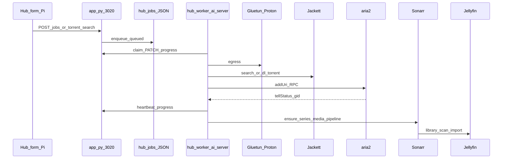

# TV and media pipeline (torrent → Sonarr → Jellyfin)

Audience: audit / PM agent. Canonical code: `homelab/bucket-hub/`. Ops detail: [`MEDIA-JELLYFIN-PIPELINE.md`](../MEDIA-JELLYFIN-PIPELINE.md), [`HUB-DOWNLOAD-DESTINATIONS.md`](../HUB-DOWNLOAD-DESTINATIONS.md), [`ARIA2-THROUGHPUT-AND-LEECH.md`](../ARIA2-THROUGHPUT-AND-LEECH.md).

## Product decision (2026-10)

**Prefer one season per queue job.** Full-series “complete” packs are discouraged: huge size, long aria2 runs, bad Sonarr monitoring defaults, and UI clutter when they fail mid-way.

| Approach | Rationale |
|----------|-----------|
| Season pack Jackett query | `{Show} season N` — avoids skew to complete-series results |
| Expansion HDD `torrents/` | aria2 inbox on exFAT; `file-allocation=none` |
| Sonarr `seasonFolder: true` | Jellyfin links episodes; flat imports orphan |
| Leech-only aria2 | No post-complete seeding; files kept for *arr import |
| Jellyfin on ai-server directly | TV app and Firefox playback; Hub proxy optional (HLS stutter) |

## End-to-end flow

## UI layer (`form.html`)

| Feature | Behaviour |
|---------|-----------|
| TV search chip | Jackett categories include anime folded into TV |
| Season bar | Per-season pips; filter results by season |
| Release badges | `complete` / `season` / `episode` from `hub_torrent_parse.py` |
| Pack search (TV) | Dual query `{title} complete` + `{title} season` when enabled — rank complete > season > episode |
| Destination | TV often pre-selects Expansion HDD + subfolder from parsed title |
| Mini queue | Shows up to 2 failed + running; **Dismiss** on error/done (2026-10 deploy) |
| Library API | `GET /api/library` — drives, nested folders for `torrents/<Show>/Season NN` |

**Planned (P0 backlog):** show-only search → Sonarr lookup → season pips only → hide/demote `full_show` without Advanced override.

## Parse and rank (`hub_torrent_parse.py`)

- `season_numbers_from_title()` — extract S01, Season 1, etc.
- `release_kind` — `full_show`, `season`, `episode`, …
- `release_kind_rank()` — sort key for UI and search
- TV category search should use **`Show season N`** for single-season intent (bare show name skews to complete packs)

## API (`app.py`)

- `POST /api/jobs` — `kind: http|magnet`, `source: torrent`, optional `torrent_meta`
- `_auto_wake_worker_if_needed()` — WoL **ubuntu** on high-priority enqueue if worker heartbeat stale
- `POST /api/jobs/{id}/dismiss` — hides `error`, `queued`, `review`, **`done`** from lists
- `POST /api/jobs/dismiss-queue` — bulk clear failed queue UI

## Worker (`hub-worker.py`)

| Stage | Notes |
|-------|--------|
| Claim + slot gate | `aria2_dispatch_allowed()` — Mbps cap + max active |
| Magnet | Metadata gid first; data gid via `followedBy`; do not complete on metadata-only |
| Jackett `/dl/` | Fetch magnet/URL on host; 302 to magnet |
| Paths | Container `dir=/mnt/torrents` → host `…/movies/torrents/` |
| Complete | `media_pipeline`: `ensure_sonarr_series_for_job`, DownloadedEpisodesScan, Jellyfin refresh + tags |
| Heartbeats | During `wait_aria2` — stale VPN badge was a past bug if heartbeats blocked |

**Critical env (ai-server `hub-worker.env`, not in git):**

- `SONARR_URL=http://127.0.0.1:8989` — must be reachable **inside Gluetun network** (not host-only wrong port)
- `JELLYFIN_URL=http://127.0.0.1:8096/jellyfin` — base URL path required
- `HUB_URL` — Pi `:3020` (LAN + Tailscale fallback)

## Pure logic (`media_pipeline.py`)

- `sonarr_add_payload_from_lookup()` — season monitoring; `complete`/`full_show` can monitor all seasons if no explicit wanted set (why complete packs are risky)
- `apply_season_monitoring()` — unit-tested without worker

## Paths (`download_destinations.py`)

- `ARIA2_TORRENTS_CONTAINER_DIR` — `/mnt/torrents`
- `validate_aria2_destination()` — must be under allowed torrent roots
- USB mount roots: `path_ready()` uses `parts[3]` under `/mnt/external/<drive>/…`

## Docker reference (`docker-compose-media.yml`)

- aria2, Jackett, Sonarr, Radarr, Jellyfin on `network_mode: service:gluetun`
- Sonarr remote path: remote `/mnt/torrents` → local `/data/torrents`
- Live compose on ai-server: `~/homelab/docker-compose.yml` (merge with reference file)

## Library state (example 2026-10-11)

| Show | In Sonarr/Jellyfin | Notes |
|------|-------------------|--------|
| Breaking Bad | Season 1 complete (7 eps) | Season pack success |
| The Office (US) | Season 1 complete (6 eps) | Complete-series jobs removed |
| Other seasons | Not imported | Queue per-season |

## Failure modes (TV-specific)

| Symptom | Likely cause |
|---------|----------------|
| Jellyfin empty, files in `torrents/` | Sonarr import not run; wrong remote path; stale container mount |
| `sonarr: add_failed` | Worker cannot reach Sonarr API; wrong URL |
| Stuck at metadata | Dead magnet; prefer Jackett `.torrent` URL |
| Resume does nothing | aria2 restarted — **Retry** clears stale `aria2_gid` |
| Error 13 on retry | Partial files without `.aria2` — purge or manual rm |
| 0 seeders forever | Swarm dead — dismiss and pick another release |
| Complete pack 80% fail | HTTP 400 / timeout — dismiss; use season pack |

## TV folder auto-creation (review this)

Human-facing destination should be understandable: **Expansion HDD → torrents → Show → Season NN**. Implementation is split across UI, library JSON, and aria2 `dir`.

| Step | Code | What it does |
|------|------|----------------|
| Path guess | `form.html` `torrentTvDestinationParts` | `torrents/<Show>/Season 01` or `Season 01-09` for ranges |
| Create folders | `ensureLibraryFolderRel` | One `POST /api/library/folders` per segment |
| Select dest | `ensureTorrentShowFolder` | TV chip only; Expansion HDD |
| Persist | `app.py` `create_folder` | `library.json` + `present: true` so enqueue is not blocked by worker scan |
| aria2 map | `download_destinations.aria2_dir_for` | Host `…/torrents/Show/Season 01` → `/mnt/torrents/Show/Season 01` |

**Known tension:** worker may still use **flat** `dir=/mnt/torrents` so the torrent’s own folder name is not double-nested. Library path and on-disk layout can disagree. Sonarr’s library is a **third** tree: `/data/tv/<Show>/Season N`.

Auditor: say whether this is understandable top-down, what to rename/simplify, and whether Hub should stop creating season folders and let Sonarr own season layout.

## Code read order (auditor)

1. `hub_torrent_parse.py`
2. `form.html` — search, `renderMiniQueue`, TV chips
3. `app.py` — `_enqueue_job`, job lifecycle
4. `download_destinations.py`
5. `hub-worker.py` — aria2 supervisor, Sonarr hooks (grep `ensure_sonarr`, `wait_aria2`)
6. `media_pipeline.py`
7. `tests/test_hub_torrent_parse.py`, `test_media_pipeline.py`, `test_job_*.py`
