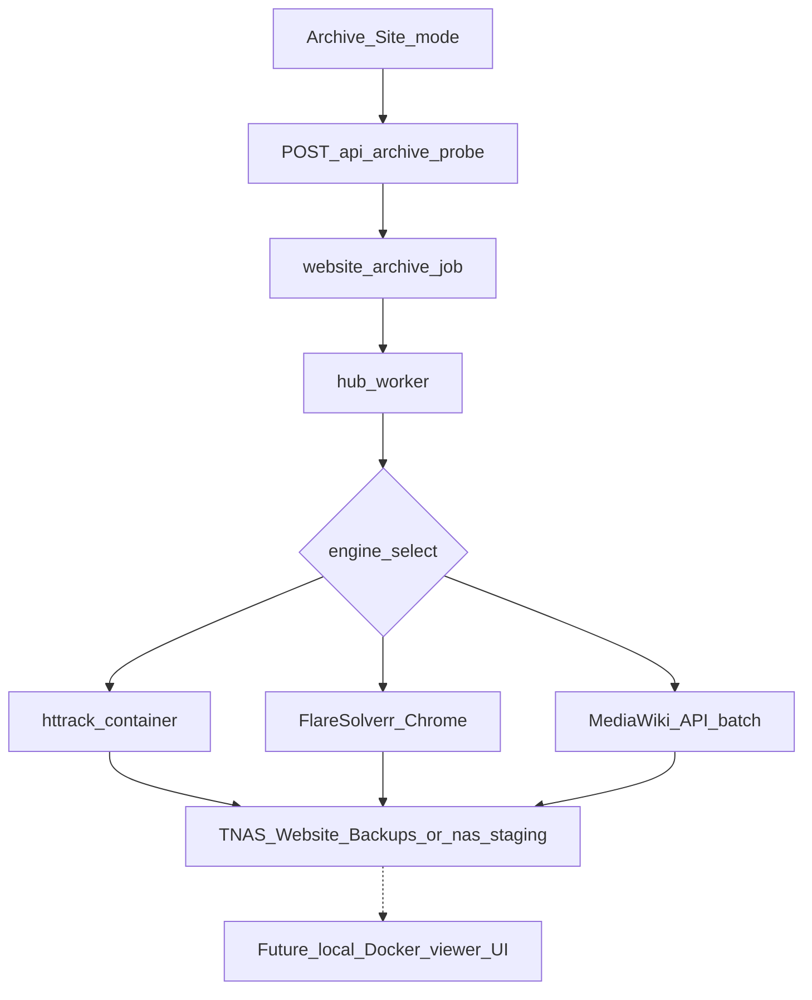

# Website archive system (clone sites for local review)

Audience: audit agent. Backlog: [`WEBSITE-ARCHIVE-TODO.md`](../WEBSITE-ARCHIVE-TODO.md). Queue UI: **Archive Site** mode in `form.html`.

## Purpose

Mirror websites (HTML + assets) through **Proton/Gluetun** on ai-server, store under **TNAS `Website Backups/<domain>/`** or **Expansion HDD `_nas_staging`** when NAS offline. Supports:

- Plain sites → **httrack** (Docker `hubhttrack`)
- Cloudflare / bot protection → **FlareSolverr** (Chrome fetch per page; JA3 — cookies alone insufficient)
- MediaWiki behind CF → **MediaWiki API** batch (50 pages/request via FlareSolverr) — reference: soyjakwiki.org scale

**Not** the same as Hub marketing copy — this is the **site cloning** product surface.

## Flow

## Hub API

| Endpoint | Role |
|----------|------|
| `POST /api/jobs` | `kind: website_archive`, `archive_depth` (0 = deep mirror per worker) |
| `POST /api/archive/probe` | Worker classifies httrack vs FlareSolverr (403 probe) |
| Job `worker` | `httrack` |

## Worker engines (`hub-worker.py`)

| Engine | When | Output layout |
|--------|------|----------------|
| httrack | Unprotected or probe says simple | Mirror tree under destination |
| FlareSolverr crawl | CF challenge | Per-page Chrome fetch; filters for junk URLs |
| MediaWiki API | Detected wiki + CF | `wikitext/`, `html/`, `page-index.json` |

Checkpoint: `.crawl-checkpoint.json` in destination (not `/tmp`). Retry should resume — visibility in UI is a backlog item.

## Destinations

| Drive | Path | When |
|-------|------|------|
| TNAS | `/mnt/tnas/Website Backups/<domain>/` | Preferred; requires mount + often **manual TNAS power/WoL** |
| Staging | `/mnt/media/_nas_staging/...` | NAS offline — UI warns; copy to TNAS later |

Hub auto-selects staging when `nas` unmounted (2026-10-09).

## UI copy (Archive mode)

- Depth `0` explained as full mirror (`-r99`), not single page
- TNAS offline warning + staging fallback strings in `form.html`
- Post-complete: `progress` files count + bytes; `.hub-job.json` sidecar on success

## Known limitations

| Limitation | Detail |
|------------|--------|
| httrack + CF cookies | TLS fingerprinting — use FlareSolverr path |
| Rate | ~500 KB/s effective on large crawls; long jobs |
| robots | httrack often `--robots=0` — polite crawl toggle backlog |
| TNAS wake | WoL from Machines panel; **hard power-off does not wake** (verified 2026-10-12) |
| VPN down | Sensitive jobs should fail-closed — verify worker gate |
| Progress | httrack less granular than FlareSolverr page counts |

## Local preview (today vs audit scope)

**Today:**

- Manual: [`scripts/soyjak-archive-viewer.py`](../../scripts/soyjak-archive-viewer.py) — serve `html/` from TNAS path
- No Hub toggle to start a read-only Docker viewer

**Auditor should scope (product, not implemented):**

- Optional UI: “Preview archive” → short-lived container (Caddy/nginx) bind-mounting `Website Backups/<domain>/`
- Security: LAN-only, no tunnel exposure by default
- Tie-in: Storage treemap deep-link after job done (backlog P2)

## Test checklist

See [`WEBSITE-ARCHIVE-TODO.md`](../WEBSITE-ARCHIVE-TODO.md) § Test checklist — e.g. `example.com` depth 2 → `_nas_staging`, verify files on disk.

## Code anchors

- `app.py` — `website_archive` enqueue, archive probe relay
- `hub-worker.py` — `_run_flaresolverr_crawl`, httrack docker invoke, MediaWiki batch, sitemap seed at depth 0
- `tests/test_job_concurrency.py` — archive jobs and claim slots
